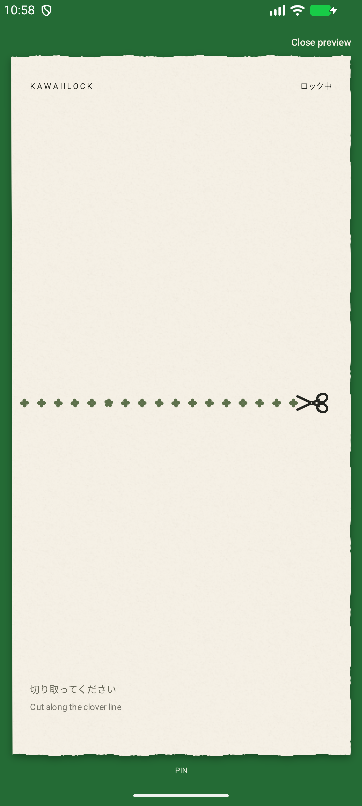

# KawaiiLock

A Kotlin Android app lock inspired by Japanese stationery. Jetpack Compose settings surround a custom Canvas paper renderer. Package: `com.kawaiilock.app`; Android 9+; compile/target SDK 36 (Android 16).



## Install and enable

1. Install the debug APK from the release assets, or build it using the instructions below. A debug APK is development-signed, not a production release.
2. Open KawaiiLock → Security → Set fallback PIN. Choose and confirm 4–12 digits.
3. Read the accessibility disclosure, then open Android accessibility settings and enable **KawaiiLock app protection**. For sideloaded apps, Android may first require App info → menu → Allow restricted settings.
4. Select apps in **Protected applications**, then enable app lock.
5. On HyperOS, allow background activity and remove battery restrictions for KawaiiLock if needed. Confirm operation on your device; manufacturer power management can interrupt accessibility services.

A separate “display over other apps” permission is unnecessary. The connected accessibility service supplies a `TYPE_ACCESSIBILITY_OVERLAY`. Home and system permission screens remain available for recovery. KawaiiLock, Android Settings and permission controllers are excluded from protection.

## Gestures and recovery

- **Drag scissors left:** cut the sheet, progressively exposing the warning. This never authenticates. A completed cut stays locked and resets after the configured delay. A partial cut returns smoothly.
- **Drag scissors right:** authenticate immediately. Start on the scissors and travel toward the screen boundary. The threshold adapts to available screen space; on a typical 412 dp display it is about 41 dp. A leftward cut cannot be reversed into an unlock in the same gesture.
- **Optional downward swipe:** start 12–100 dp above the five-leaf clover and swipe through the line. Default landmark is the nearest clover to 30% from the left. Only one symbol has five leaves. Disabling the shortcut renders all symbols with four leaves. Change position and sensitivity in Secret shortcut.
- **PIN:** tap the discreet PIN label at the bottom. With a screen reader, activate the paper lock to open PIN authentication. Five failed attempts impose a persistent 30-second cooldown, increasing to a maximum of 16 minutes.

PIN verifiers use PBKDF2-HMAC-SHA256, 210,000 iterations, a 32-byte random salt and a 256-bit result, compared in constant time. PINs are never stored or logged in plaintext. Derivation runs off the UI thread. Back does not dismiss protection. Backup is disabled.

If you forget every recovery method, press Home, disable the service in Android Accessibility settings, then clear KawaiiLock’s app data or reinstall. This resets the PIN and app selection. There is no master PIN. This offers casual privacy, not system-level security: a device owner can revoke accessibility, uninstall the app, or clear its data.

## Build in Android Studio or the terminal

Requirements: Android Studio with JDK 17 or newer (bundled JBR 21 works), Android SDK 36 and network access for initial Gradle dependencies. Open this directory in Android Studio and let it sync. Put the local SDK path in your untracked `local.properties`, or export `ANDROID_HOME`.

```sh
chmod +x gradlew
./gradlew assembleDebug testDebugUnitTest lintDebug
./gradlew connectedDebugAndroidTest   # Android emulator/device, test-only environment
./gradlew assembleRelease
adb install -r app/build/outputs/apk/debug/app-debug.apk
```

`assembleRelease` produces **app-release-unsigned.apk**. It cannot be installed until signed with your own release key. Android Studio → Build → Generate Signed App Bundle or APK completes signing. Do not commit keys, passwords, or `local.properties`. The release build enables `FLAG_SECURE` on the protection overlay; the debug build permits QA screenshots.

Instrumentation integration tests temporarily change accessibility settings, install test PINs and select Google Clock/Chrome, then restore preferences and the previous accessibility-service list. Run those tests on an emulator or dedicated test device, not your everyday phone. The security tests use isolated preferences. `scripts/capture_screenshots.py` captures debug preview stages and settings on an idle emulator.

## Architecture

- `LockEngine.kt`: pure Kotlin gesture recognition, clover placement, deterministic cut contours, relock policy.
- `PaperRenderer.kt`: cached fibre/grain texture, irregular paper contour, separate warning layer, geometry-clipped sheet separation, botanical guide and articulated vector scissors.
- `PaperView.kt`: input capture, blade motion tied to distance, reset animation, feedback and accessible PIN entry action. Rendering stops when input/animation stops.
- `ProtectedAppMonitor.kt`: event-driven foreground window detection, one touch-blocking accessibility overlay, screen-off and foreground timeout handling, native accessible PIN keypad. It uses package identities only and never reads screen text.
- `SettingsRepository.kt`: persistent local settings and salted PIN verifier.
- `MainActivity.kt`: Compose settings, searchable launchable-app selection, preview, disclosure, PIN setup/change and recovery guidance.

Every visible preference updates stored behavior. No networking permission, analytics, advertising or constant foreground polling. Sessions are memory-only; process restarts fail closed.

## Validation and limitations

See [QA report](docs/QA.md) for the actual build, emulator results and remaining checks. The supplied reference is preserved in `design/kawaiilock-final-reference.png`; it is design guidance, not a static lock-screen asset.

The paper separation uses deterministic 2D contours and edge shading, not a full 3D cloth simulation. Successful authentication removes protection immediately; it currently does not retain a separate peel animation above the newly accessible app. Optional audio is a quiet feedback tone, not a recorded paper sound. Android does not allow third-party app locks to guarantee zero frames of the destination before an accessibility event. Split-screen, floating windows, OEM battery management, Android system dialogs and Poco F7/HyperOS operation require device verification. System bars remain accessible intentionally.
